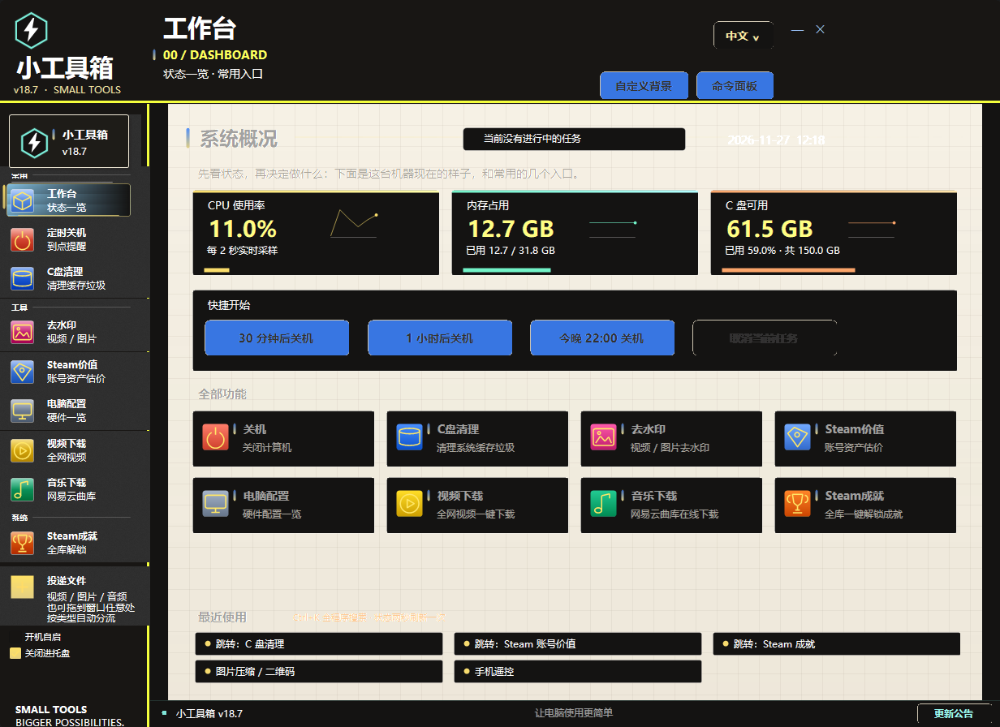

# 小工具箱 · MiniToolbox

[](https://github.com/wj5666619/MiniToolbox/releases/latest)
[](https://github.com/wj5666619/MiniToolbox/releases)
[](#)
[](#)

**官网 · 下载页**：<https://wj5666619.github.io/MiniToolbox/> ｜ **最新版**：v19.3 ｜ **免安装 · 单文件 · 源码公开**

一台电脑的小事，交给它就行：定时关机、C 盘清理、Steam 进阶、视频与音乐下载、去水印、局域网剪贴板、录屏、单文件加密……20+ 项日常工具打包进一个 exe，双击就跑，不写注册表、不留后台服务，五套皮肤一键换。


## 下载

| 渠道 | 文件 | 说明 |
| --- | --- | --- |
| 最新版（推荐） | [MiniToolbox.exe](https://github.com/wj5666619/MiniToolbox/releases/latest/download/MiniToolbox.exe) | 单文件主程序，2,084,240 字节 |
| 压缩包 | [MiniToolbox_v19.3.7z](https://github.com/wj5666619/MiniToolbox/releases) | 940,995 字节，含 exe 与说明 |
| 全部版本 | [Releases](https://github.com/wj5666619/MiniToolbox/releases) | 全部 tag，可回退旧版 |

校验（v19.3）：

```
SHA256  8b846fe5b249c65bb8dff81e577ac081acd667d5acbb4deaa08e8721ab8cc6dc
```

> 程序使用自签名证书，作者本机可信；他人电脑首次运行可能提示「未知发布者」，属正常现象，可对照上面的哈希确认文件未被改动。

## 能做什么

| 分类 | 工具 |
| --- | --- |
| 系统 | 定时关机（可撤销 / 历史记录）、C 盘清理（分类勾选、删进回收站） |
| 游戏 | Steam 进阶：库清单、价格与愿望单、节点测速 |
| 媒体 | 视频 / 音乐下载、去水印、录屏 / GIF 工坊、图片批量压缩 |
| 文件 | 批量重命名与格式转换、重复文件清理、单文件加密（.mtbx） |
| 效率 | 全局热键中心、局域网剪贴板、剪贴板历史、指令舱（Ctrl+K）、手机互传 |
| 扩展 | 插件仓库（内置示例 + 远程源 + 离线缓存） |

界面：五套皮肤（新粗野 / 赛博 HUD / 弹性色块 / 静谧便当 / 纸感手绘），外观设置里可预览、调 95–115% 缩放、跟随系统 DPI。

 

## 快速上手

1. 下载 `MiniToolbox.exe`，放到任意目录（建议非系统盘）。
2. 双击运行，首次启动有三步引导：功能概览 → 选皮肤 → 音效与托盘说明。
3. 顶部搜索框或 `Ctrl+K` 指令舱，输几个字就能跳到任意功能。

## 本版改动（v19.3）

- 新增官方网站：<https://wj5666619.github.io/MiniToolbox/>，含下载、功能、皮肤、实拍截图、更新日志与构建说明。
- 关于页「源码与编译」重写：给出仓库与官网地址、真实的 125 文件源码结构、`build.ps1` 与 csc 命令。

### v19.2 改动

- 精简增强中心：16 张卡收到 13 张，「隐私痕迹清理」「v7.1 七项新工具」「v7.2 五项新工具」入口撤下。
- v7.2 只保留高清录屏；页头副标题与指令舱同步去掉对应条目。

## 自动更新

启动 25 秒后后台读取仓库根目录的 `update.json`，比对 `version`；有新版本则按 `url` 下载，校验 `size` 与 `sha256`，通过才替换并重启。清单支持多源，校验失败自动换下一个源。

## 从源码构建

需要 .NET Framework 4.x 自带的 `csc.exe`，无需 Visual Studio、无需 NuGet。

```powershell
.\build.ps1          # 编译 → 签名 → 算 SHA256 写 update.json → 7z 打包
.\build.ps1 -NoSign  # 跳过签名
```

只编 `定时关机.cs` 会缺类型，必须带 `Src\*.cs`：

```powershell
csc.exe /nologo /target:winexe /optimize+ /codepage:65001 `
  /win32icon:定时关机.ico /out:小工具箱.exe 定时关机.cs Src\*.cs
```

## 目录

```
定时关机.cs          入口、主窗口骨架、RoundBtn 自绘控件
Src\               125 个类型文件（各功能页、皮肤、音效、配置）
官网\              官方网站静态页（同 docs\，由 GitHub Pages 发布）
发布\              update 清单、README、签名与上传脚本
build.ps1          一键构建
```

## 常见问题

**需要安装吗？** 不需要，单个 exe，退出不写注册表；卸载直接删文件。

**会联网吗？** 只在检查更新、查 Steam 价格、下载你指定的内容时联网；剪贴板、清理记录、配置均只存本地。

**支持哪些系统？** Windows 10 / 11 为主，Win 8.1 可运行。

## 说明

源码公开，欢迎读、改、提 Issue。二次分发请保留出处与本仓库链接；自签名证书不随代码分发，自行构建的版本请自行签名。

- Issues：<https://github.com/wj5666619/MiniToolbox/issues>
- 官网：<https://wj5666619.github.io/MiniToolbox/>
