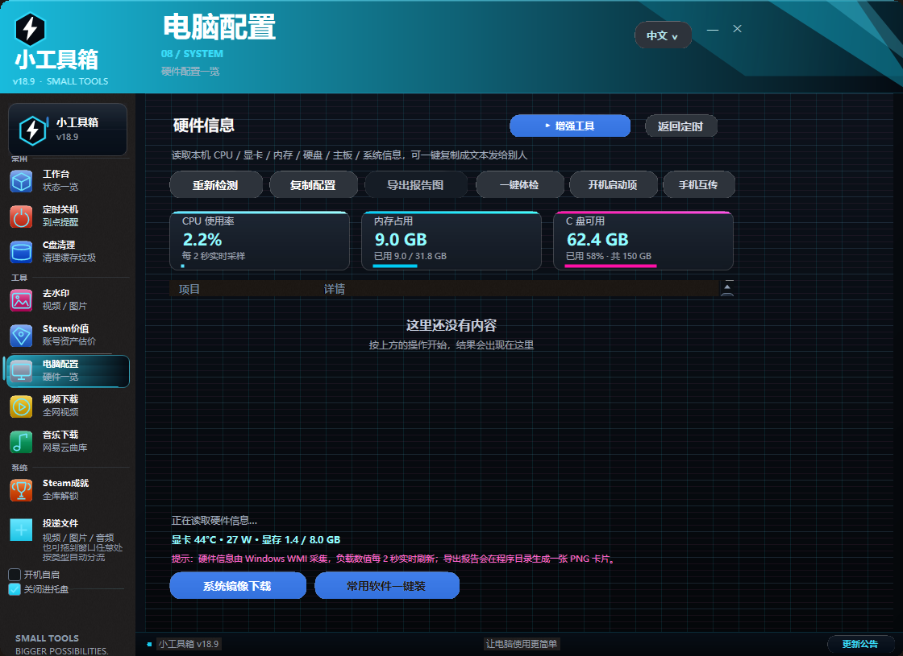
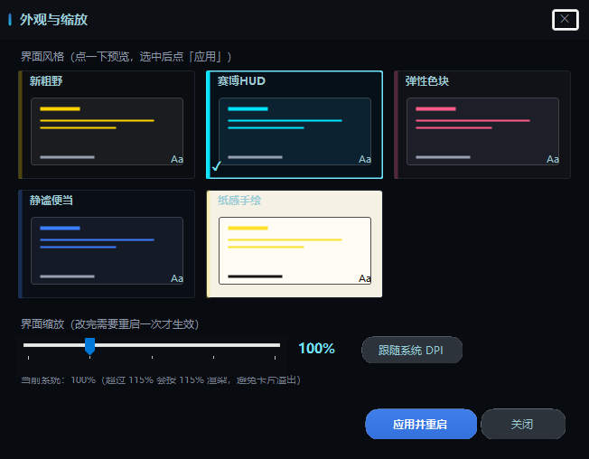

# 小工具箱 · MiniToolbox

[](https://github.com/wj5666619/MiniToolbox/releases/latest)
[](https://github.com/wj5666619/MiniToolbox/actions/workflows/build.yml)
[](https://github.com/wj5666619/MiniToolbox/releases)
[](#)
[](#)
[](LICENSE)
[](#企业部署)

**官网 · 下载页**：<https://wj5666619.github.io/MiniToolbox/> ｜ **最新版**：v19.15 ｜ **免安装 · 单文件 · 源码公开 · 企业就绪**

一台电脑的小事，交给它就行：定时关机、C 盘清理、Steam 进阶、视频与音乐下载、去水印、局域网剪贴板、录屏、单文件加密……26+ 项日常工具，外加 88 个网页工具（首次打开按需下载离线包），主程序单文件 3.37 MB，双击就跑，不写注册表、不留后台服务，五套皮肤一键换。企业环境另有策略管控、审计日志、更新验签与部署脚本。

> 仓库已包含完整可编译源码（入口 `定时关机.cs` + `Src/` 144 个 C# 文件）、构建脚本、部署脚本、GitHub Actions、官网与社区文档。下载二进制请以 [Releases](https://github.com/wj5666619/MiniToolbox/releases) 为准。



## 下载

| 渠道 | 文件 | 说明 |
| --- | --- | --- |
| 最新版（推荐） | [MiniToolbox.exe](https://github.com/wj5666619/MiniToolbox/releases/latest/download/MiniToolbox.exe) | 单文件主程序，3,370,896 字节 |
| 压缩包 | [MiniToolbox_v19.15.7z](https://github.com/wj5666619/MiniToolbox/releases) | 1,235,477 字节，含 exe 与说明 |
| 工具站离线包 | [ToolSite.zip](https://github.com/wj5666619/MiniToolbox/releases/latest/download/ToolSite.zip) | 22,709,509 字节；可选，放到程序目录可免首次下载 |
| 全部版本 | [Releases](https://github.com/wj5666619/MiniToolbox/releases) | 全部 tag，可回退旧版 |

校验（v19.15）：

```
SHA256  b8d2a498398677aa4d7e7e05cdc3d2c9c5c9e3a7ffcaee323833a1506e3bc38f
```

> 程序使用自签名证书，作者本机可信；他人电脑首次运行可能提示「未知发布者」，属正常现象，可对照上面的哈希确认文件未被改动。

## 能做什么

| 分类 | 工具 |
| --- | --- |
| 系统 | 定时关机（可撤销 / 历史记录）、C 盘清理（分类勾选、删进回收站） |
| 游戏 | Steam 进阶：库清单、价格与愿望单、节点测速 |
| 媒体 | 视频 / 音乐下载、去水印、录屏 / GIF 工坊、图片批量压缩 |
| 文件 | 批量重命名与格式转换、重复文件清理、单文件加密（.mtbx） |
| 效率 | 全局热键中心、局域网剪贴板、剪贴板历史、指令舱（Ctrl+K）、手机互传 |
| 实用 | 文件哈希校验、图片取色与主色板、电子印章、图片 Base64、时间戳转换、强随机密码 |
| 工具站 | 88 个开源工具：图像、文档、开发、媒体、办公、生活、设计、安全、数据、硬件、趣味 11 类，带搜索与分类；离线包按需加载 |
| 扩展 | 插件仓库（内置示例 + 远程源 + 离线缓存） |

界面：五套皮肤（新粗野 / 赛博 HUD / 弹性色块 / 静谧便当 / 纸感手绘），外观设置里可预览、调 95–115% 缩放、跟随系统 DPI。



## 快速上手

1. 下载 `MiniToolbox.exe`，放到任意目录（建议非系统盘）。
2. 双击运行，首次启动有三步引导：功能概览 → 选皮肤 → 音效与托盘说明。
3. 顶部搜索框或 `Ctrl+K` 指令舱，输几个字就能跳到任意功能。

## 源码与社区

| 入口 | 用途 |
| --- | --- |
| [源码目录](Src) | 144 个 C# 文件：主窗口、各功能页、皮肤、音效、配置、诊断、策略、审计、验签 |
| [build.ps1](build.ps1) | 一键编译、可选签名、计算 SHA256、写 update.json、7z 打包 |
| [官网源码](docs/index.html) | GitHub Pages 静态站，含下载、功能矩阵、皮肤演示、企业说明、校验与 FAQ |
| [CHANGELOG.md](CHANGELOG.md) | 按版本记录功能、修复与破坏性变更 |
| [CONTRIBUTING.md](CONTRIBUTING.md) | 构建环境、代码风格、提交与 PR 流程 |
| [SECURITY.md](SECURITY.md) | 漏洞披露渠道、响应时限与安全边界 |
| [LICENSE](LICENSE) | MIT；第三方组件许可见 [THIRD-PARTY-NOTICES.md](THIRD-PARTY-NOTICES.md) |
| [Issues](https://github.com/wj5666619/MiniToolbox/issues) | Bug 报告与功能建议，附模板与日志要求 |
| [Actions](https://github.com/wj5666619/MiniToolbox/actions/workflows/build.yml) | Windows CI：每次 push / tag 编译并留存构建产物 |

> 源码可读、可改、可自行构建；发布版二进制以 Releases 资产为准。构建需要 .NET Framework 4.x 自带的 `csc.exe`，不依赖 Visual Studio 或 NuGet。

## 企业部署

面向公司 / 机房 / 多台机器：策略可下发、敏感动作留痕、更新验签、安装卸载脚本化。个人用户不配置就完全不受影响。

| 文件 | 用途 |
| --- | --- |
| [企业管理指南.md](企业管理指南.md) | 策略字段、审计动作、验签规则、排障路径 |
| [部署.ps1](部署.ps1) | `-Install` / `-Uninstall` / `-Status` / `-MachinePolicy`，装到 `%LOCALAPPDATA%`，无需管理员 |
| [策略示例.json](策略示例.json) | 可直接改用的策略模板 |

策略读取顺序：`%ProgramData%\MiniToolbox\策略.json`（全员）→ 程序目录 `策略.json`（覆盖）。只收紧不放宽，删掉即恢复默认。

```json
{
  "禁用在线更新": true,
  "禁用诊断导出": false,
  "详细日志": false,
  "禁用功能": ["video", "music"]
}
```

```powershell
.\部署.ps1 -Install -AutoStart   # 装到当前用户并开机自启
.\部署.ps1 -Status               # 版本 / 快捷方式 / 自启 / 卸载项
.\部署.ps1 -MachinePolicy        # 生成机器级策略模板（需管理员）
```

- 审计日志 `日志\审计.log`：启动退出、系统清理、一键重装、安装更新、拒绝更新、导出诊断包，1MB 滚动两份。
- 更新验签：`SHA256` 通过后还要比对证书指纹，和当前程序不是同一张证书直接拒绝。
- 诊断包：关于页导出 zip（版本环境 + 最近日志 + 配置），不含聊天记录、密码库、剪贴板内容。

## 本版改动（v19.15）

- 体积精简：主程序从 26.08 MB 降到 3.37 MB，7z 包 1.23 MB；88 个工具的 22.7 MB 离线包不再内嵌。
- 工具站改为按需加载：优先读程序目录 `工具站.zip` / `ToolSite.zip` / `site.zip`，没有就从官网 Pages 下载并缓存，失败会提示手动放置。
- 清理旧版本 7z、测试 exe、临时编译目录、调试截图、诊断包、重复封面、重复工具站包与可再生成的组件缓存，项目目录从 386.9 MB 降至 64.4 MB。
- FFmpeg / 视频组件包改为官网 Pages 按需下载，首次使用视频功能时自动部署，之后本地复用。
- 原有控制中心、任务中心、皮肤、音效和更新链路保持不变。

### v19.13 改动

- 工作台「全部功能」新增「工具站」磁贴，独立深色窗口打开，整站 88 个开源工具离线可用。
- 覆盖图像 / 文档 / 开发 / 媒体 / 办公 / 生活 / 设计 / 安全 / 数据 / 硬件 / 趣味 11 类，自带搜索与分类，首页点卡片即用。
- 全部在本机 WebView2 内核运行，文件不上传服务器；首次打开解压约 45 MB，之后离线秒开，todo / habit 等本地数据保留。
- 工具站源码为 MIT 许可（3top.top / e-CNY），离线包内保留 LICENSE 与来源说明，只把唯一外链预览图换成本地文件。
- 该版曾因离线资源全部进单文件，主程序由 2.2 MB 增至 26 MB；v19.15 已将工具站外置并按需加载。

### v19.12 改动

- 「反馈与建议」现在把诊断包发到 m18371900557@163.com，不再只提示“发给开发者”。
- 点「是」后自动复制邮件正文（版本、Windows 版本、诊断包路径、问题模板）并打开邮箱：有桌面邮件应用直接开写信窗口；没有则打开 163 网页邮箱。
- 诊断包需在邮件里手动作为附件添加；导出、审计与策略开关保持不变。

### v19.11 改动

- 工作台新增「实用工具」磁贴，点开独立深色小窗，六件常用小工具集中在一处。
- 文件哈希校验：MD5 / SHA-1 / SHA-256 / SHA-512，支持粘贴官方哈希一键比对。
- 图片取色与配色：点图任意位置取色，载入即提取 10 色主色板，复制 HEX。
- 电子印章：环形文字、五角星、做旧质感，支持朱红 / 深蓝 / 墨黑与透明 PNG 导出。
- 图片 Base64 双向互转、Unix 时间戳双向换算、16 位强随机密码批量生成；全部本机内存完成，不联网、不上传。
- v19.9 企业能力保留：策略、审计、更新验签、部署脚本不变。

### v19.10 改动

- 下线「投递文件」：侧栏入口、整窗拖放与投递遮罩一并撤掉。
- 文件拖进窗口不再触发分流跳转，需要处理文件时进对应功能页选择。
- 「开机自启」「关闭进托盘」两个开关上移，补上原投递卡片的位置，侧栏不再留空档。

### v19.9 改动

- 企业策略：程序目录或 `%ProgramData%\MiniToolbox\策略.json` 可禁用在线更新、禁用诊断导出、禁用指定功能页、强制详细日志；被禁用的页在侧栏与 `/go:` 跳转时都会被拦下。
- 审计日志：`日志\审计.log` 记录启动退出、系统清理、一键重装、安装更新、拒绝更新、导出诊断包，1MB 滚动两份。
- 更新包验签：除 SHA256 外，还校验新包证书指纹必须与当前程序一致，不一致或未签名直接拒绝。
- 企业部署：`部署.ps1` 支持安装 / 卸载 / 状态 / 机器级策略模板，装到 `%LOCALAPPDATA%`，注册开始菜单与「应用和功能」卸载项，无需管理员。
- 主程序补上文件版本号（19.9.0.0），资源管理器、任务管理器、卸载列表都可见。

详见 [企业管理指南.md](企业管理指南.md)。

### v19.8 改动

- 全仓 1,182 处空 `catch {}` 接入统一忽略日志：默认零开销（一次布尔判断即返回），只有配置里 `diagVerbose=true` 才逐条写 TRACE。
- 详细日志带位置：`已忽略 MainForm.Ui.cs:3837 | NullReferenceException: ...`，排障直接跳文件行，不用再猜哪里被吞。
- `MainForm.cs` 由 23,926 行拆成 6 个 partial 文件：界面构建与页面切换、Steam 解锁与工作台、首页与 Steam 价值、电脑配置/去水印/下载/音乐、壁纸与动效。
- 拆分后日志标签自动重算到新文件与真实行号，拆文件不影响日志可读性；编译产物与界面行为与 19.7 一致。
### v19.7 改动

- 统一诊断日志：`日志\小工具箱.log` 分级记录，1MB 自动滚动保留 3 份；路径、用户名与令牌样式落盘前脱敏。
- 启动头一次写齐版本、系统、.NET、屏幕与工作区、启动参数、启动耗时，排查不用再问用户环境。
- 崩溃窗口升级：错误摘要 + 「重新启动 / 打开日志 / 复制诊断 / 继续使用」，后台线程异常退回系统提示，不再只是一个是/否框。
- 配置原子写：先写 `.tmp`，再 `Replace` 成正式文件并留 `.bak`；JSON 损坏时隔离为 `配置_损坏_*.json` 并从备份恢复，原因进日志。
- 启动自检：磁盘剩余、从临时目录运行、系统时钟异常、配置目录状态、单实例互斥体失败降级，全部只记录不打断启动。
- 关于页「反馈与建议」改为导出诊断包 zip：版本与环境 + 最近日志 + 配置，一个文件即可反馈。
- 更新链路留痕：候选源数量、SHA256 校验失败、每个源的下载失败、替换就绪都写日志。

### v19.6 改动

- 窗口位置记忆：退出时记录 x / y 与最大化状态，下次启动回到原处；屏幕变化或坐标越界时自动回主屏居中。
- 双击标题栏最大化 / 还原，按工作区尺寸展开，不盖任务栏；无边框窗体下也保持内容列居中。
- 单实例唤醒：再次双击 exe 不再弹提示框，直接激活已运行窗口；新增 `/go:槽名` 参数可直接落到指定页（如 `/go:clean`、`/go:music`）。
- 音效面板夜间静默时段可自定义：起止整点用深色时间菜单选择，写入 `音效夜间时段.txt`；`Esc` 先关面板、再退回工作台。
- 外观面板新增四套主题包（静谧便当 / 赛博霓虹 / 弹性色块 / 纸感手绘），皮肤与音色一次切换。
- 关于页新增「官方网站」入口，可直接打开看截图与更新日志。

### v19.5 改动

- 侧栏与功能卡图标底板统一到青绿 / 青 / 蓝 / 灰蓝一套冷色系，不再出现红黄粉混色。
- 右上角语言胶囊、最小化、关闭统一为同款圆角底板、同高 32px，悬停统一提亮。
- 功能卡图标与标题纵向对齐修正，文字块整体下移 3px，64px 卡高内视觉居中。

### v19.4 改动

- 工作台重排：壁纸只在页面上半部露脸，下半部渐隐压深，文字与卡片不再被背景照片干扰。
- 快捷开始分出层级：30 分钟为主按钮实心，1 小时 / 今晚 22:00 为次级，取消改为低调的灰字按钮。
- 最近使用去掉[跳转：]前缀、右侧加箭头；功能卡悬停出现同色箭头，说明字号 7.5改8。
- 内存卡副标题由[已用 x / y GB]改成[共 y GB · 占用 x%]，不再和主数字重复。

### v19.3 改动

- 新增官方网站：<https://wj5666619.github.io/MiniToolbox/>，含下载、功能、皮肤、实拍截图、更新日志与构建说明。
- 关于页「源码与编译」重写：给出仓库与官网地址、源码结构、`build.ps1` 与 csc 命令。

### v19.2 改动

- 精简增强中心：16 张卡收到 13 张，「隐私痕迹清理」「v7.1 七项新工具」「v7.2 五项新工具」入口撤下。
- v7.2 只保留高清录屏；页头副标题与指令舱同步去掉对应条目。

## 自动更新

启动 25 秒后后台读取仓库根目录的 `update.json`，比对 `version`；有新版本则按 `url` 下载，校验 `size` 与 `sha256`，通过才替换并重启。清单支持多源，校验失败自动换下一个源。

## 从源码构建

需要 .NET Framework 4.x 自带的 `csc.exe`，无需 Visual Studio、无需 NuGet。构建前确认根目录存在 `定时关机.ico`、`皮肤.txt`、`sam_tool.zip`、`clean_tool.zip`，以及 `refs\WV2Core.dll`、`WV2WinForms.dll`、`WV2Loader32.dll`、`WV2Loader64.dll`；输出为 `小工具箱.exe`，并把版本、大小、SHA256 写入 `发布\update.json`（克隆仓库无 `发布\` 时写入根目录 `update.json`，不会自动发 Release）。

```powershell
.\build.ps1          # 编译 → 签名 → 算 SHA256 写 update.json → 7z 打包
.\build.ps1 -NoSign  # 跳过签名，适合本地验证
```

> 仓库源码对应开发中的 v19.15 维护版；Release 里的二进制是已发布构建。自行构建的 exe 版本号与哈希可能不同，请以自己的 `update.json` 为准，不要覆盖官方发布资产。

只编 `定时关机.cs` 会缺类型，必须带 `Src\*.cs`：

```powershell
csc.exe /nologo /target:winexe /optimize+ /codepage:65001 `
  /win32icon:定时关机.ico /out:小工具箱.exe 定时关机.cs Src\*.cs
```

## 目录

```
定时关机.cs          入口、主窗口骨架、RoundBtn 自绘控件
Src\               144 个源文件（各功能页、皮肤、音效、配置、诊断、策略、审计、验签）
docs\              官方网站静态页（GitHub Pages 发布目录）
refs\              WebView2 托管 DLL（编译引用 + 内嵌资源）
发布\              本地发版工作区（不上传；根目录 update.json 才是线上清单）
.github\           Actions 构建与 Issue / PR 模板
部署.ps1           企业安装 / 卸载 / 状态 / 机器级策略模板
策略示例.json       企业策略模板
企业管理指南.md     策略字段、审计动作、验签与排障说明
build.ps1          一键构建
LICENSE            MIT 许可证（原始代码）
THIRD-PARTY-NOTICES.md  第三方组件与许可说明
```

## 常见问题

**需要安装吗？** 不需要，单个 exe，退出不写注册表；卸载直接删文件。

**会联网吗？** 只在检查更新、查 Steam 价格、下载你指定的内容时联网；剪贴板、清理记录、配置均只存本地。

**支持哪些系统？** Windows 10 / 11 为主，Win 8.1 可运行。

## 安全与许可

- **安全披露**：请不要用公开 Issue 提交可被利用的漏洞；按 [SECURITY.md](SECURITY.md) 的私密渠道联系，附最小复现与版本号。
- **校验发布包**：只从 Releases 或官网下载，下载后核对页面公布的 SHA256；自签名证书只用于作者发布链路，不替代哈希校验。
- **源码许可**：原始代码采用 [MIT](LICENSE)。仓库内嵌或按需下载的第三方组件（如 Light-Help、FFmpeg、7-Zip、工具站项目）沿用各自许可证，详见 [THIRD-PARTY-NOTICES.md](THIRD-PARTY-NOTICES.md)。
- **二次分发**：请保留出处、许可证与第三方声明；自签名证书不随代码分发，自行构建的版本请自行签名。

- Issues：<https://github.com/wj5666619/MiniToolbox/issues>
- 官网：<https://wj5666619.github.io/MiniToolbox/>
- 更新日志：[CHANGELOG.md](CHANGELOG.md)
- 贡献指南：[CONTRIBUTING.md](CONTRIBUTING.md)
- 企业管理指南：<https://github.com/wj5666619/MiniToolbox/blob/main/企业管理指南.md>
- 部署脚本：<https://github.com/wj5666619/MiniToolbox/blob/main/部署.ps1>
- 策略模板：<https://github.com/wj5666619/MiniToolbox/blob/main/策略示例.json>
